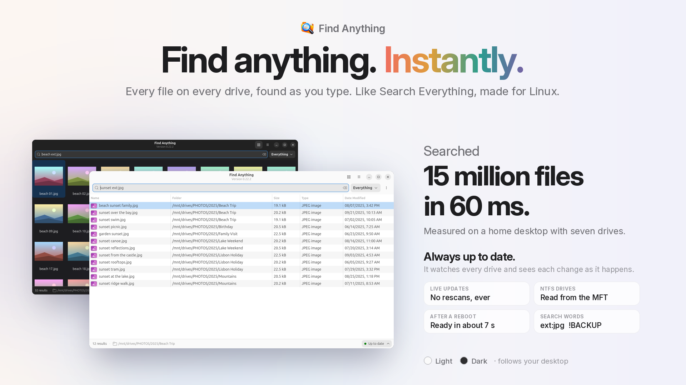

https://github.com/user-attachments/assets/a4cc27a7-3def-4cc4-8ca1-0474f81dbff4

# Find Anything

Instant file search for Linux, like Search Everything on Windows. A small background service keeps a live index of every drive, and the window searches it as you type.

## Why Find Anything

- **Fast:** searches 15 million files in about 60 ms (measured on a home desktop with seven drives). Results update with every key you press.
- **Always Current:** the service watches every drive with the kernel's fanotify interface, so a new, renamed or deleted file shows up within moments. No 15-minute rescans, no nightly `updatedb`.
- **Quick Starts:** the index is saved; after a reboot it loads and checks only what changed while it was off. Ready in about 7 s on the same 15-million-file desktop.
- **NTFS Drives:** shared Windows drives (ntfs3 driver) are read straight from their file table, the MFT: about 2 million files in under 1.5 s.
- **Every Drive:** the system drive, data drives and USB keys (picked up when plugged in, dropped when ejected).
- **Pictures:** a thumbnail grid and a preview pane for photos.
- **Light And Dark:** a GTK 4 and libadwaita window that follows your desktop's style.

## How It Differs From FSearch And locate

- **FSearch and locate/plocate:** build their database by rescanning folders, on a timer or once a day. Anything created since the last scan is missing, and each rescan walks every folder again.
- **Find Anything:** scans once, then follows the kernel's change events. The index stays right without rescanning, and drives the kernel can't watch (such as NTFS-3g) are re-checked on a timer and marked so in the window.
- **Like Search Everything:** the same idea as the well-known Windows tool (one always-current index of every file name, results as you type), built for Linux.

## Why It Needs Root

- **The Service Runs As Root:** watching a whole filesystem with fanotify, opening files by their kernel handle and reading an NTFS drive's file table all need root (`CAP_SYS_ADMIN`, `CAP_DAC_READ_SEARCH`).
- **The Window Does Not:** `fa-gui` runs as you and talks to the service over a local socket that only your user can open (mode 0600).
- **No Network:** neither program opens a network connection; there is no telemetry.
- **Your Choice:** install it as a systemd service that starts at boot (recommended), or start it from the window when you need it (asks for your password through pkexec).
- **Clean Removal:** `uninstall.sh`, plus every installed file listed in `INSTALL_SERVICE.md`.

## Requirements

- **System:** Linux with glibc 2.39+, GTK 4.12+ and libadwaita 1.5+ (Ubuntu 24.04+, Fedora 40+).
- **Kernel:** 5.17+ (6.8+ for live updates on btrfs).
- **Tools:** `pkexec` and systemd, preinstalled on Ubuntu and Fedora.
- **Live Drives:** ext4, XFS, btrfs and NTFS with the ntfs3 driver. Other drives are indexed and re-checked on a timer.

## Install

1. **Download:** get `FindAnything_v0.22.2_linux_x86_64.tar.gz` from [Releases](../../releases) and unpack it in your home folder.
2. **Install The Service:** in the unpacked folder run `sh install.sh` as yourself (not with sudo). It lists what it will do and asks before doing it.
3. **Open:** press Super, type "Find Anything", press Enter. The first index takes a few minutes; every later start takes seconds.

Full steps, updating, going back a version and uninstalling: [`INSTALL.md`](INSTALL.md). Every file the service installs: [`INSTALL_SERVICE.md`](INSTALL_SERVICE.md).

## Build From Source

- **Needs:** Rust (stable) and the GTK 4 and libadwaita development packages (Ubuntu: `libgtk-4-dev libadwaita-1-dev`; Fedora: `gtk4-devel libadwaita-devel`).
- **Build:** `cargo build --release --locked`, copy `target/release/fa` and `target/release/fa-gui` next to `install.sh`, then run `sh install.sh`.
- **Dependencies:** three crates (`gtk4`, `libadwaita`, `libc`) and their own dependencies, pinned in `Cargo.lock`.

## Search Words

- **Words:** `holiday photo` matches both words in any order; `jpg | png` matches either.
- **Leave Out:** `!BACKUP` leaves out anything with that word, whole drives included.
- **Narrow It:** `ext:pdf`, `image:`, `folder:`, `parent:/path`, wildcards (`IMG_????.jpg`) and `"exact phrase"`.
- **Inside Files:** `content:invoice` also reads the files for that word.

The full list is in [`INSTALL.md`](INSTALL.md) and in the window under Preferences > Search Words. The `fa` command line uses the same words: `fa find 'ext:png holiday'`.

## Support

- **Issues:** bug reports and ideas are welcome in [Issues](../../issues). The window's status panel has Report an Issue, which saves a small report you can attach.
- **Coffee:** if Find Anything saves you time, you can [buy me a coffee](https://buymeacoffee.com/droidstreamer).

## License

- **GPL-3.0-or-later:** see [`LICENSE`](LICENSE). By Droid.
